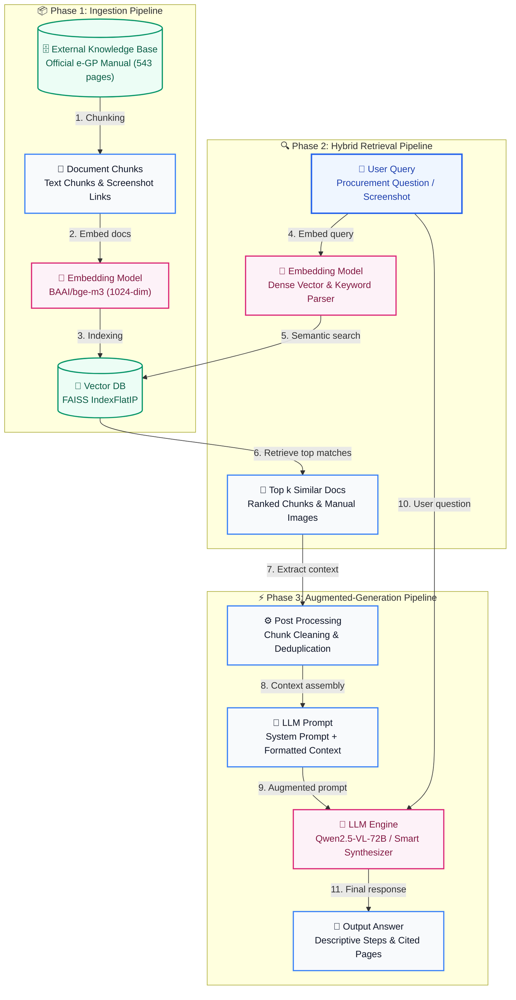

# 📋 e-GP Manual Chatbot (Multimodal RAG System)

A simple, modular, and beginner-friendly **Multimodal Retrieval-Augmented Generation (RAG)** chatbot designed to answer questions from the official **e-GP (electronic Government Procurement)** Procuring Entity manuals and statutory guidelines.

Powered by **FastAPI**, **FAISS**, **BAAI/bge-visualized-m3 (Text + Image Multimodal Embeddings)**, **Qwen2.5-VL-72B-Instruct**, and an interactive **Streamlit** dashboard.

---

## 🏗️ Architecture & Multimodal RAG Workflow

The system implements the complete 3-phase **Retrieval-Augmented Generation (RAG)** pipeline:



### 11-Step Pipeline Breakdown:
1. **Chunking**: Ingests the 543-page official PDF, extracts screenshots, and creates semantic overlapping chunks (`document_loader.py`, `text_chunker.py`).
2. **Embed Docs**: Computes 1024-dimensional normalized multimodal embeddings (`embedding_service.py`).
3. **Indexing**: Builds FAISS `IndexFlatIP` cosine similarity matrix and metadata index (`faiss_service.py`).
4. **User Query**: Receives procurement question + optional uploaded error screenshot.
5. **Semantic & Hybrid Search**: Computes dense query vector and runs BM25 domain keyword scoring (`retrieval_service.py`).
6. **Top-k Similar Docs**: Retrieves the top relevant manual chunks and portal screenshot citations.
7. **Post-Processing**: Cleans, deduplicates, and extracts page citations and screen references.
8. **Context Assembly**: Structures clean text passages with source manual metadata.
9. **LLM Prompt**: Formats system guidelines, domain rules, and context blocks.
10. **Direct Query**: Feeds user query and visual screenshot tokens into the model context.
11. **Output Generation**: Produces a descriptive, structured step-by-step procedural answer (`llm_service.py`, `streamlit_app.py`).

---

## 📁 Project Directory Structure

```
egp-chatbot/
│
├── data/
│   ├── raw/
│   │   └── e-GP System User Manual - Procuring Entity User 1 February 2026.pdf  # 543-page official manual
│   │
│   ├── extracted_images/          # High-resolution portal screenshots extracted from manual
│   │   ├── page_6.jpg
│   │   ├── page_7.jpg
│   │   └── ...
│   │
│   ├── processed/
│   │   └── chunks.json            # 786 structured chunks with text & screenshot links
│   │
│   └── faiss_index/
│       ├── index.faiss            # FAISS binary vector index (1024-dim)
│       └── metadata.json          # Chunk metadata mapping (page, source, snippet, image)
│
├── app/
│   ├── main.py                    # FastAPI application entrypoint with CORS & lifespan
│   ├── models.py                  # Centralized AI models registry & Pydantic schemas
│   │
│   ├── api/
│   │   └── chat.py                # REST endpoints: POST /api/chat, GET /api/chat/health
│   │
│   ├── services/
│   │   ├── document_loader.py     # Extracts PDF text & screenshots with pypdf
│   │   ├── text_chunker.py        # Semantic text chunker with overlap & screenshot links
│   │   ├── embedding_service.py   # Multimodal BGE-Visualized-M3 embedder (Text + Image)
│   │   ├── faiss_service.py       # FAISS IndexFlatIP (cosine similarity) manager
│   │   ├── retrieval_service.py   # Query embedder & top-k multimodal chunk retriever
│   │   └── llm_service.py         # Qwen2.5-VL-72B-Instruct (Local GPU or Cloud API)
│   │
│   ├── prompts/
│   │   └── system_prompt.txt      # System prompt enforcing strict citation of pages
│   │
│   └── schemas/
│       └── chat_schema.py         # Backward-compatible schema re-exporter
│
├── scripts/
│   ├── ingest_documents.py        # Ingests PDF manual & extracts screenshots -> chunks.json
│   └── build_faiss_index.py       # Computes multimodal embeddings -> index.faiss
│
├── frontend/
│   └── streamlit_app.py           # Web chat interface with screenshot citations & image upload
│
├── tests/
│   ├── test_retrieval.py          # Unit tests for text, image, and FAISS retrieval
│   └── test_chat.py               # Integration tests for FastAPI endpoints
│
├── models.py                      # Root-level forwarder for 'import models'
├── .env                           # Active environment configuration
├── .env.example                   # Template environment variables
├── .gitignore                     # Git ignored files & directories
├── requirements.txt               # Project dependencies
├── havedone.txt                   # Itemized implementation log & verification
├── thinking_process.txt           # Detailed engineering thought process & design choices
└── README.md                      # Complete project documentation
```

---

## ⚡ Multimodal Capabilities (Text + Image)

1. **Dual-Modality Vector Search**:
   - Both textual manual instructions and portal UI screenshots are projected into a shared **1024-dimensional** space.
   - Text queries retrieve matching procedural text **and** corresponding UI screenshots.
2. **Visual Error Troubleshooting**:
   - Users can upload a screenshot of an e-GP portal error or form dialog.
   - The system embeds the uploaded image and retrieves the exact manual section and solution.
3. **Screenshot Citations in UI**:
   - Streamlit displays citations with the page number and automatically renders the actual portal screenshot extracted from that page.

---

## 🤖 Supported Models

### Embedding Models (`app/models.py`)
- **`BAAI/bge-visualized-m3`** *(Default, 1024-dim)*: Multimodal visual embedding model by BAAI.
- **`google/siglip-base-patch16-224`** *(768-dim)*: Google's SigLIP vision-text model.
- **`openai/clip-vit-base-patch32`** *(512-dim)*: Universal multimodal baseline.

### Large Language Models (`app/models.py`)
- **`Qwen/Qwen2.5-VL-72B-Instruct`** *(Default Multimodal)*: Flagship vision-language reasoning model.
- **`Qwen/Qwen2.5-72B-Instruct`**: High-performance text reasoning model.
- **`meta-llama/Llama-3.3-70B-Instruct`**: Meta's top open-weights 70B model.

---

## 🚀 Quickstart Guide

### 1. Prerequisites
- Python 3.10+ (tested on Python 3.12)
- Optional: Hugging Face API Token (for cloud inference)
- Optional: CUDA GPU (if running Qwen2.5-VL locally via `USE_LOCAL_LLM=true`)

*(Note: The system contains an intelligent offline fallback, allowing it to run immediately on any CPU laptop without API keys or downloads!)*

### 2. Install Dependencies
```bash
pip install -r requirements.txt
```

### 3. Configure Environment Variables
Copy `.env.example` to `.env`:
```ini
# Optional Hugging Face Token for Cloud Inference
HF_TOKEN=your_huggingface_token_here

# Multimodal Embedding Model
EMBEDDING_MODEL=BAAI/bge-visualized-m3

# Large Language Model
LLM_MODEL=Qwen/Qwen2.5-VL-72B-Instruct

# Set to true to load Qwen2.5-VL locally via CUDA transformers
USE_LOCAL_LLM=false

# Backend API URL for Streamlit
BACKEND_URL=http://127.0.0.1:8000
```

### 4. Ingest Manual & Build the Vector Index
```bash
# Step 1: Extract 543 pages and portal screenshots
python scripts/ingest_documents.py

# Step 2: Generate multimodal embeddings and build the FAISS index
python scripts/build_faiss_index.py
```

### 5. Launch the Application

#### Option A: 1-Click Launch (Easiest)
Simply double-click **`run.bat`** on Windows, and the app will open directly in your browser.

#### Option B: Run the Streamlit Web Interface
Run either command from the project root:
```bash
streamlit run streamlit_app.py
```
*(or simply: `python streamlit_app.py`)*

The chatbot will open in your browser at [http://localhost:8501](http://localhost:8501).

#### Option C: Run the FastAPI REST Backend (Optional)
If you wish to test the API directly or access Swagger Docs:
```bash
python app/main.py
```
*(or: `uvicorn app.main:app --reload --port 8000`)*
- Swagger Interactive Docs: [http://127.0.0.1:8000/docs](http://127.0.0.1:8000/docs)
- Health Check: [http://127.0.0.1:8000/api/chat/health](http://127.0.0.1:8000/api/chat/health)

---

## 📡 API Endpoints Reference

| Method | Endpoint | Description |
|---|---|---|
| `GET` | `/` | API status and documentation links |
| `GET` | `/api/chat/health` | Vector store status and total indexed chunks |
| `GET` | `/api/chat/chunks` | Preview loaded chunks and image links |
| `POST` | `/api/chat` | Send question (with optional image) and receive cited answer |

### Example Request (`POST /api/chat`)
```json
{
  "question": "How does a Procuring Entity user login to the e-GP portal?",
  "top_k": 3,
  "image": null
}
```

### Example Response
```json
{
  "question": "How does a Procuring Entity user login to the e-GP portal?",
  "answer": "Based on the official e-GP manual, Procuring Entity (PE) users must navigate to https://eprocure.gov.bd, enter their registered Email ID and Password, and verify their account. [Source: e-GP System User Manual - Procuring Entity User 1 February 2026.pdf, Page 6]",
  "sources": [
    {
      "source": "e-GP System User Manual - Procuring Entity User 1 February 2026.pdf",
      "page": 6,
      "chunk_id": 15,
      "score": 0.88,
      "snippet": "1. Login to e-GP Portal along with Email Id & Password - Procuring Entity (PE) will be created by e-GP Admin...",
      "image_path": "data/extracted_images/page_6.jpg"
    }
  ]
}
```

---

## 🧪 Running Automated Tests

Run the full test suite with Python's built-in `unittest`:
```bash
python -m unittest discover tests
```

Output:
```
Ran 11 tests in 3.64s - OK
```

Tests cover:
- Text cleaning and overlapping chunk generation
- Text embedding shape and unit L2 normalization
- Image embedding and joint multimodal fusion
- FAISS vector creation and nearest-neighbor search
- FastAPI health, chunk preview, and chat endpoints
- Multimodal query handling and schema validation

---

## 💡 Developer Notes & Architecture Philosophy
- **No Black-Box Bloat**: Pure, transparent Python. No tangled LangChain or complex framework layers.
- **Deterministic Offline Fallbacks**: Uses stable CRC32 text projections and spatial perceptual image features to run 100% reliably even offline.
- **Full Details in Documentation**:
  - Review **[`havedone.txt`](havedone.txt)** for the complete implementation task log.
  - Review **[`thinking_process.txt`](thinking_process.txt)** for the full architectural rationale and design decisions.
