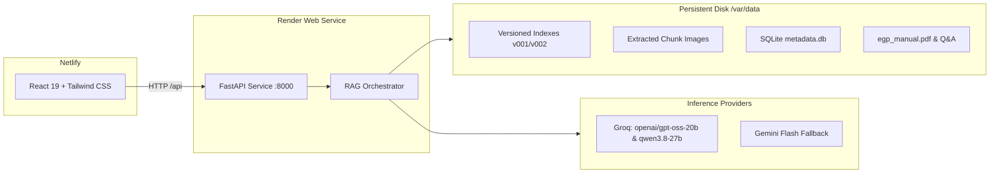

# Deployment Guide: Bangladesh e-GP Manual Assistant

This guide details deployment procedures for the **e-GP Manual Assistant**, covering local development, persistent disk storage on Render, and frontend deployment on Netlify.

---

## 1. System Architecture & Components



---

## 2. Local Environment Setup & Launch

### 2.1 Prerequisites
- **Python**: 3.10+ (tested on Python 3.12.10).
- **Node.js**: 20+ (tested on Node 22).
- **Manual Assets**: Ensure `data/raw/egp_manual.pdf` and `data/raw/e-GP System Q&A.txt` are present.

### 2.2 One-Click Windows Launch (`run.bat`)
Run the interactive launcher from the project root:
```powershell
.\run.bat
```
Select:
- **`[1]`** &rarr; Start Full Stack (FastAPI Backend on `:8000` + React Frontend on `:3000`).
- **`[2]`** &rarr; Start React Frontend Only (`:3000`).
- **`[3]`** &rarr; Start FastAPI Backend Only (`:8000`).

*(Note: You can also execute `.\run.bat` directly from inside the `backend/` directory).*

### 2.3 Manual Terminal Launch

**Terminal 1 — Backend:**
```powershell
cd backend
python -m uvicorn app.main:app --host 127.0.0.1 --port 8000 --reload
```

**Terminal 2 — Frontend:**
```powershell
cd frontend
npm run dev
```

The application will be live at:
- **Frontend UI**: `http://localhost:3000`
- **Backend API**: `http://127.0.0.1:8000`
- **Swagger Docs**: `http://127.0.0.1:8000/docs`

---

## 3. Environment Variables Configuration (`.env`)

Configure your `.env` in the project root:

```ini
# ==========================================
# Bangladesh e-GP Official Manual Assistant
# Enterprise Multimodal RAG Environment Config
# ==========================================

# 1. Hosted LLM Inference
GROQ_API_KEY=your_groq_api_key_here
GROQ_TEXT_MODEL=openai/gpt-oss-20b
GROQ_VISION_MODEL=qwen/qwen3.8-27b
GEMINI_API_KEY=your_gemini_api_key_here
GEMINI_MODEL=gemini-flash-latest

# 2. Embedding & Vision Models
EMBEDDING_MODEL=BAAI/bge-m3
VISION_EMBEDDING_MODEL=google/siglip-base-patch16-224
RERANKER_MODEL=BAAI/bge-reranker-v2-m3

# 3. Optional Local Inference (Requires GPU)
USE_LOCAL_LLM=false
LOCAL_LLM_MODEL=Qwen/Qwen2.5-VL-3B-Instruct

# 4. Service Hosts and Ports
BACKEND_HOST=127.0.0.1
BACKEND_PORT=8000
FRONTEND_PORT=3000
CORS_ORIGINS=http://localhost:3000,http://127.0.0.1:3000

# 5. Local Data and Index Paths
DATA_RAW_DIR=data/raw
PROCESSED_DATA_PATH=data/processed/chunks.json
EXTRACTED_IMAGES_DIR=data/extracted_images
INDEXES_DIR=data/indexes
FAISS_INDEX_PATH=data/faiss_index/index.faiss
FAISS_METADATA_PATH=data/faiss_index/metadata.json
```

---

## 4. Production Deployment: Render (FastAPI Web Service)

### 4.1 Persistent Disk Architecture
Because the e-GP manual contains 543 pages and over 1,000 diagrams, **never rebuild embeddings on service startup**. Attach a persistent disk to the Render service:

| Disk Parameter | Setting |
|---|---|
| **Mount Path** | `/var/data` |
| **Indexes Directory** | `/var/data/egp/indexes` |
| **Images Directory** | `/var/data/egp/images` |
| **Metadata Database** | `/var/data/egp/indexes/v001/metadata.db` |
| **Raw Documents** | `/var/data/egp/raw` |
| **Active Version Pointer** | `/var/data/egp/indexes/active_version.json` |

### 4.2 Render Service Settings

Depending on whether your Render Web Service Root Directory is set to `backend` or the repository root:

**Option A: Root Directory = `backend` (Standard Render Web Service)**
- **Root Directory**: `backend`
- **Environment**: Python 3.12 / 3.14
- **Build Command**: `pip install -r requirements.txt`
- **Start Command**: `python -m uvicorn app.main:app --host 0.0.0.0 --port $PORT`
- **Health Check Path**: `/health`

**Option B: Root Directory = `.` (Repository Root)**
- **Root Directory**: `.`
- **Environment**: Python 3.12 / 3.14
- **Build Command**: `pip install -r backend/requirements.txt`
- **Start Command**: `python -m uvicorn backend.app.main:app --host 0.0.0.0 --port $PORT`
- **Health Check Path**: `/health`

> [!NOTE]
> **Resilient Data Directory Fallback (`_resolve_data_dir()`)**
> If `EGP_DATA_DIR=/var/data/egp` is configured in `.env` but no persistent disk is mounted (e.g. during initial testing or on ephemeral free-tier instances), the server automatically catches `PermissionError: [Errno 13]` during directory probe checks and safely falls back to the committed `data/` directory (or `/tmp/egp_data`), guaranteeing that `uvicorn` boots cleanly without crashing.

### 4.3 Maintenance & Indexing Workflow
To build or upgrade an index version in production without interrupting active users:
1. Open the Render Web Shell.
2. Run the index build into version `v002`:
   ```bash
   python backend/scripts/build_indexes.py --version v002
   ```
3. Validate the new index:
   ```bash
   python backend/scripts/validate_indexes.py --version v002
   ```
4. Atomically promote `v002` to active:
   ```bash
   python backend/scripts/build_indexes.py --version v002 --activate
   ```
   *The FastAPI server reads `active_version.json` without downtime.*

---

## 5. Production Deployment: Netlify (React Frontend)

### 5.1 Netlify Build Settings
Configure `frontend/netlify.toml`:
```toml
[build]
  base = "frontend"
  command = "npm install && npm run build"
  publish = "dist"

[context.production.environment]
  VITE_API_BASE_URL = "https://your-render-backend.onrender.com"
```

### 5.2 Build Verification
```powershell
cd frontend
npm run build
```
Build output produces an optimized bundle in `frontend/dist/`.
