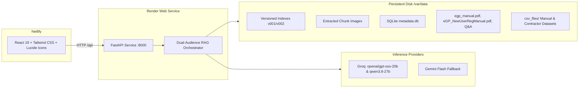

# Deployment Guide: Bangladesh e-GP Manual Assistant

This guide details deployment procedures for the **e-GP Manual Assistant (Proca)**, covering local development, persistent disk storage on Render, and frontend deployment on Netlify.

---

## 1. System Architecture & Components



---

## 2. Local Environment Setup & Launch

### 2.1 Prerequisites
- **Python**: 3.10+ (tested on Python 3.12.10).
- **Node.js**: 20+ (tested on Node 22).
- **Manual Assets**: Ensure `data/raw/egp_manual.pdf`, `data/raw/e-GP System Q&A.txt`, and `csv_files/` datasets are present.

### 2.2 One-Click Windows Launch (`run.bat`)
Run the interactive launcher from the project root:
```powershell
.\run.bat
```
Select:
- **`[1]`** &rarr; Start Full Stack (FastAPI Backend on `:8000` + React Frontend on `:3000`).
- **`[2]`** &rarr; Start React Frontend Only (`:3000`).
- **`[3]`** &rarr; Start FastAPI Backend Only (`:8000`).

### 2.3 Manual Terminal Launch

**Terminal 1 — Backend:**
```powershell
cd backend
python -m uvicorn app.main:app --host 127.0.0.1 --port 8000 --reload
```

**Terminal 2 — Frontend:**
```powershell
cd frontend
npm run dev
```

---

## 3. Production Deployment (Render + Netlify)

### 3.1 Backend Deployment on Render

1. **Service Type**: Web Service (Python).
2. **Build Command**:
   ```bash
   pip install --upgrade pip
   pip install -r backend/requirements.txt
   ```
3. **Start Command**:
   ```bash
   cd backend && python -m uvicorn app.main:app --host 0.0.0.0 --port $PORT --workers 2
   ```
4. **Environment Variables**:
   - `GROQ_API_KEY`: Groq Cloud API key.
   - `GEMINI_API_KEY`: Optional Google AI Studio key for fallback.
   - `CORS_ORIGINS`: Comma-separated allowed client origins (e.g., `https://your-app.netlify.app`).
   - `DATA_DIR`: Path to persistent data storage (e.g., `/var/data`).

### 3.2 Frontend Deployment on Netlify

1. **Build Settings**:
   - **Base directory**: `frontend`
   - **Build command**: `npm run build`
   - **Publish directory**: `frontend/dist`
2. **Environment Variables**:
   - `VITE_API_BASE`: Full URL of the deployed FastAPI backend (e.g., `https://your-backend.onrender.com`).
3. **Routing Configuration**: `netlify.toml` in the repository root handles single-page application (SPA) routing:
   ```toml
   [[redirects]]
     from = "/*"
     to = "/index.html"
     status = 200
   ```

---

## 4. Health Checks & Verification

After deployment, verify the deployment:

1. **Health Endpoint**:
   ```bash
   curl -s https://your-backend.onrender.com/health | jq .
   ```
2. **RAG Status**:
   ```bash
   curl -s https://your-backend.onrender.com/api/rag/status | jq .
   ```
3. **Test Retrieval**:
   ```bash
   curl -s -X POST https://your-backend.onrender.com/api/chat \
     -H "Content-Type: application/json" \
     -d '{"question": "How to Verify National ID for PE and Vendor Accounts?"}' | jq .
   ```
