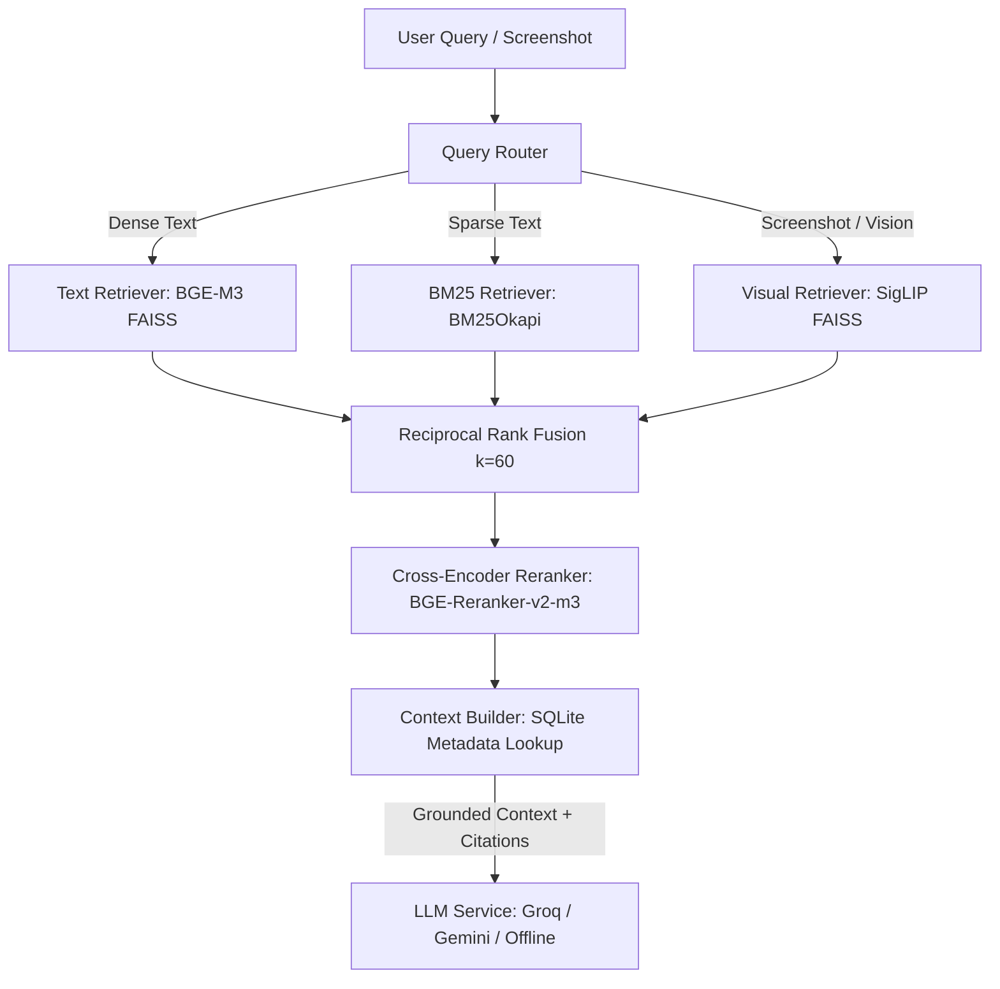

# Embeddings & Retrieval Pipeline Documentation

This guide details the **multimodal, multi-channel embedding and indexing pipeline** for the Bangladesh e-GP (Electronic Government Procurement) Manual Assistant.

---

## 1. Overview & Architecture

The e-GP assistant implements an enterprise-grade RAG pipeline that combines dense vector embeddings, sparse lexical retrieval, visual screenshot embeddings, and cross-encoder reranking:

| Component | Technology | Representation / Dimension | Role |
|---|---|---|---|
| **Dense Text Embeddings** | `BAAI/bge-m3` | 1024-dim dense vector (L2-normalized) | Semantic retrieval across 543 manual pages and supplemental Q&A |
| **Sparse Lexical Retrieval** | `rank-bm25` (BM25Okapi) | Inverted term index | Exact keyword, rule identifier (e.g., PPR Rule 127), and tender ID search |
| **Visual Embeddings** | `google/siglip-base-patch16-224` | 768-dim visual feature vector | Screenshot-to-manual page retrieval and visual UI matching |
| **Reranker** | `BAAI/bge-reranker-v2-m3` | Cross-encoder relevance score | Post-fusion precision reranking of top candidate passages |
| **Rank Fusion** | Reciprocal Rank Fusion (RRF) | Constant $k=60$ | Unbiased score combination across dense, sparse, and visual channels |
| **Metadata Store** | SQLite (`metadata.db`) | Relational chunk records | Fast indexed lookups by chunk ID, page, category, and image path |

---

## 2. Directory & Versioning Layout

Indexes are managed using **immutable versioned directories** with an atomic pointer (`active_version.json`). Production serving is never blocked or overwritten during indexing:

```text
data/indexes/
├── active_version.json              # Points to currently active version (e.g. {"active_version": "v001"})
└── v001/
    ├── pdf_text.faiss               # BGE-M3 dense FAISS IndexIDMap2(IndexFlatIP) (1,188 vectors)
    ├── bm25.pkl                     # Serialized BM25Okapi index
    ├── metadata.db                  # SQLite database storing all chunk records & image mappings
    └── manifest.json                # Cryptographic checksums, dimensions, model IDs, build timestamp
```

### Active Version Pointer (`active_version.json`)
```json
{
  "active_version": "v001",
  "activated_at": "2026-11-12T12:00:00.000000Z",
  "activated_by": "build_indexes.py"
}
```

---

## 3. Structure-Aware Chunk Image Extraction

Rather than capturing arbitrary whole-page screenshots, embedded portal screens, workflow charts, and diagrams are extracted directly from PDF raster objects and mapped to their exact owning chunks:

### Storage Location
- **Extracted Images**: `data/extracted_images/chunks/`
- **Central Registry**: `data/extracted_images/images_manifest.json`

### File Naming Convention
$$\text{chunk\_\{chunk\_id\}\_page\_\{page\}\_\{order\}\_\{sentence\_slug\}.png}$$

**Examples:**
- `chunk_19_page_6_0_screen_a1.jpg` &rarr; First-time login screen
- `chunk_101_page_35_0_screen_c16.jpg` &rarr; Workflow creation interface
- `chunk_145_page_54_0_screen_d1.png` &rarr; Tender preparation step guide
- `chunk_413_page_178_0_screen_d50.jpg` &rarr; Cancellation process link on tender dashboard

### Associated Metadata Fields
Each chunk in `chunks.json`, `metadata.json`, and `metadata.db` carries:
- `chunk_id`: Integer or string identifier (e.g., `145` or `pdf:145`).
- `page`: PDF page number (1–543).
- `image_path`: Relative disk path (`data/extracted_images/chunks/...`).
- `related_sentence`: Exact descriptive sentence from the manual referring to the screen.
- `screen_reference`: Identifier (e.g., `Screen - D1`, `Screen - D50`, `Screen - A6`).
- `content_type`: `"multimodal"` if a verified image is attached, else `"text"`.

---

## 4. Pipeline Execution Scripts

### 4.1 Rebuild Structured Images
Extracts all 1,096 raster images from `data/raw/egp_manual.pdf`, aligns them to the 1,188 chunks, and writes the image manifest:
```bash
python backend/scripts/rebuild_chunk_images.py
```

### 4.2 Build Versioned Indexes
Builds FAISS dense index, BM25 index, and SQLite metadata store into a new version directory:
```bash
python backend/scripts/build_indexes.py --version v001 --activate
```

### 4.3 Validate Index Integrity
Runs the 9-point validation suite (vector count, dimensionality, normalization, SQLite tables, manifest schema, and a test retrieval query):
```bash
python backend/scripts/validate_indexes.py --version v001
```

### 4.4 End-to-End Ingestion Pipeline
Executes the full 12-phase ingestion (parsing &rarr; page rendering &rarr; OCR &rarr; chunking &rarr; embeddings &rarr; index build &rarr; validation &rarr; atomic activation):
```bash
python backend/scripts/ingest_all.py --version v002 --activate
```

### 4.5 Evaluate Retrieval Quality
Runs retrieval benchmarking against statutory test queries:
```bash
# Evaluate legacy retrieval service
python backend/scripts/evaluate_retrieval.py

# Evaluate upgraded RAG service on a specific version
python backend/scripts/evaluate_retrieval.py --rag-version v001
```

---

## 5. Query Retrieval Flow



1. **Routing**: Analyzes query intent (general, fee schedule, exact procedure, or vision).
2. **Multi-Channel Retrieval**: Queries dense FAISS index, BM25 inverted index, and SigLIP visual index in parallel.
3. **Reciprocal Rank Fusion (RRF)**: Merges candidates using rank position ($RRF\_score = \sum \frac{1}{60 + rank}$).
4. **Cross-Encoder Reranker**: Computes token-level joint relevance scores for top 15 candidates.
5. **Context Builder**: Pulls full passage text, section headers, statutory page numbers, and exact chunk image URLs from `metadata.db`.
6. **Answer Synthesis**: LLM generates a grounded, structured answer with verified citations and diagrams.
