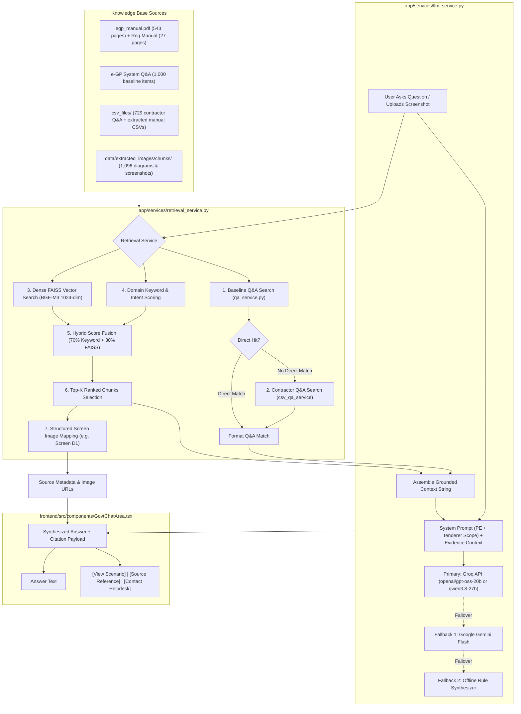

# Project Architecture: Enterprise Multimodal RAG Assistant

This document details the production architecture and the **End-to-End Retrieval Flow** of the **Bangladesh e-GP Official Manual Assistant (user)**, built to support both **Procuring Entities (PEs)** and **Tenderers / Contractors / Vendors** nationwide.

---

## 1. System Architecture Overview

Architecture diagrams are available in both full component and simplified sequence formats:
- Full System Component Diagram: [`PROJECT_ARCHITECTURE.puml`](file:///e:/E-gp%20Project%20manual/documents/PROJECT_ARCHITECTURE.puml)
- Simplified Sequence & Failover Diagram: [`SIMPLE_ARCHITECTURE.puml`](file:///e:/E-gp%20Project%20manual/documents/SIMPLE_ARCHITECTURE.puml)

```mermaid
flowchart TD
    subgraph Client [Client Presentation Layer - React 19 + Tailwind CSS]
        UI[Government-Themed Chat Workspace]
        GH[GovernmentHeader: e-GP PE & Tenderer Manuals 570 pages]
        SB[GovtOfficialSidebar: Module & Topic Navigation]
        CA[GovtChatArea: FormattedGovtText & Markdown Tables]
        ACT[MessageActionButtons: Scenario Image | Source Reference | Contact Helpdesk]
    end

    subgraph API [FastAPI Service Layer :8000]
        Router[API Gateway / CORS / Validation]
        ChatAPI["/api/chat & /api/chat/vision"]
        ManualAPI["/api/manual (Pages & Chunk Images)"]
        RagAPI["/api/rag & /health"]
    end

    subgraph RAG [Retrieval & Ranking Engine]
        QR[Dual-Audience Query Router]
        Dense[BGE-M3 Dense Retriever - 1024-dim]
        Sparse[BM25Okapi Lexical Retriever]
        Vision[SigLIP Visual Feature Retriever - 768-dim]
        RRF[Reciuserl Rank Fusion k=60]
        Reranker[BGE-Reranker-v2-m3 Cross-Encoder]
        ContextBuilder[Context & Citation Assembly]
    end

    subgraph Inference [Multimodal LLM Layer]
        GroqText["Groq: openai/gpt-oss-20b (Primary Text)"]
        GroqVision["Groq: qwen/qwen3.8-27b (Vision / Screenshot)"]
        GeminiFB["Google Gemini Flash Fallback"]
        OfflineSyn["Offline Grounded Synthesizer + Helpdesk Escalation"]
    end

    subgraph Storage [Data, CSV & Versioned Index Layer]
        ActivePtr[active_version.json]
        V001["Version v001 Index Store"]
        FAISS[(pdf_text.faiss - 1188 vectors)]
        BM25[(bm25.pkl)]
        SQLite[(metadata.db SQLite)]
        ChunkImages["data/extracted_images/chunks/ (1096 images)"]
        RawDocs["egp_manual.pdf (543 pages) + eGP_NewUserRegManual (27 pages)"]
        CSVFiles["csv_files/ (manual extracted, registration, 729 contractor Q&A)"]
    end

    UI --> Router
    Router --> ChatAPI & ManualAPI & RagAPI
    ChatAPI --> QR
    QR --> Dense & Sparse & Vision
    Dense & Sparse & Vision --> RRF
    RRF --> Reranker
    Reranker --> ContextBuilder
    ContextBuilder --> GroqText & GroqVision
    GroqText -.->|Failover| GeminiFB
    GeminiFB -.->|Failover| OfflineSyn
    ContextBuilder -.-> SQLite & FAISS & BM25 & CSVFiles
    ManualAPI --> ChunkImages
    V001 --- FAISS & BM25 & SQLite
    ActivePtr --> V001
    CA --> ACT
```

---

## 2. Core Architectural Layers

### 2.1 Presentation Layer (Frontend)
- **Framework**: React 19 with Vite, TypeScript, Tailwind CSS, and Lucide icons.
- **Dual-Audience Positioning**: Configured to serve both Procuring Entities and Tenderers/Contractors with clear domain context (tendering, e-BG, bid submission, evaluation, debarment).
- **Interactive Action Pills (`MessageActionButtons`)**:
  - 🖼️ **`View Scenario — Screen / Page`**: Collapsible button that dynamically expands to display high-resolution manual screen diagrams or cropped screenshots, complete with prev/next carousel pagination.
  - 📖 **`Source Reference`**: Collapsible pill displaying statutory manual page numbers (e.g., `p. 199, p. 415`) and supplemental Q&A question identifiers.
  - 📞 **`Contact Helpdesk`**: Collapsible pill providing direct access to BPPA/CPTU Helpdesk contacts.
- **Contextual Screenshot Upload**: Accepts user portal screenshots, runs verification, and submits for multimodal OCR/vision alignment.

### 2.2 API & Serving Layer (Backend)
- **Framework**: FastAPI (asynchronous ASGI, Python 3.12).
- **Dual-Audience Prompt Engine**: `backend/app/prompts/system_prompt.txt` equips the assistant with comprehensive procurement knowledge across:
  - **Procuring Entity (PE) Operations**: APP preparation, TEC/TOC formation, tender creation, tender opening, evaluation report submission, approval workflows, NOA issuance, contract signing.
  - **Tenderer / Contractor Operations**: Registration, e-GP merchant bank mapping, tender document purchase, e-Payment, e-BG (Bank Guarantee) mapping, online bid preparation, BOQ encryption/submission, joint venture configurations.
- **Security & Integrity**: Magic-byte image validation, strict input bounds, and CORS policies.

### 2.3 Knowledge Base & Multi-Channel Retrieval
- **Official Raw Manuals**:
  - `egp_manual.pdf` (543 pages — official comprehensive PE manual).
  - `eGP_NewUserRegManual_English.pdf` (27 pages — contractor & user registration manual).
  - `e-GP System Q&A.txt` / `.docx` (1,000 official baseline procedural Q&A pairs).
- **CSV Data Source Layer (`csv_files/`)**:
  - `egp_manual_extracted.csv`: Complete structured extraction of the 543-page user manual.
  - `egp_registration_manual_extracted.csv`: Structured extraction of the 27-page user registration manual.
  - `egp_contractor_evaluation_dataset.csv`: 729 comprehensive question-and-answer pairs covering contractor and evaluation workflows.
- **Retrieval Engine**:
  - **Dense Channel**: FAISS `IndexIDMap2(IndexFlatIP)` with BGE-M3 1024-dimensional normalized vectors.
  - **Sparse Channel**: BM25Okapi inverted index covering statutory clauses (PPR-2008, PPA-2006) and exact system error codes.
  - **Visual Channel**: SigLIP 768-dimensional feature matcher for portal screen comparison.
  - **Fusion & Rerank**: Reciuserl Rank Fusion ($k=60$) followed by BGE-Reranker-v2-m3 cross-encoding.

### 2.4 Structure-Aware Chunk Image Ingestion
- **Extracted Images**: 1,096 screen images extracted from manual PDFs with PyMuPDF.
- **Chunk Alignment**: Each visual asset maps directly to `chunk_id`, `page`, `screen_reference`, and `related_sentence`.
- **Filesystem Format**: `chunk_{chunk_id}_page_{page}_{order}_{slug}.png` under `data/extracted_images/chunks/`.

### 2.5 Inference Failover & Official Helpdesk Escalation
- **Primary Inference**: Groq-hosted `openai/gpt-oss-20b` (text queries) and `qwen/qwen3.8-27b` (vision/screenshot queries).
- **Secondary Fallback**: Google Gemini (`gemini-flash-latest`) automatic failover.
- **Offline Synthesizer**: Fully offline grounded synthesis when no API key is available or network is isolated.
- **Helpdesk Escalation Policy**:
  - If a user asks a question with **no grounded answer** in the manuals or Q&A base, the system explicitly states that the requested procedure is not covered in the official documentation and renders the full Helpdesk contact block directly.
  - After **every answer**, the user is provided a clickable horizontal action button to contact the Helpdesk for further details.
  - **Official Contacts**:
    - 📞 **e-GP Helpdesk Hotline:** `16575` *(from any mobile network in Bangladesh)*
    - ☎️ **Telephone Support:** `+880 9609112233` / `+880 1762625528–31`
    - ✉️ **Email Support:** `helpdesk@eprocure.gov.bd` / `e-gphelpdesk@cptu.gov.bd`
    - 🌐 **Official Portal:** [eprocure.gov.bd](https://www.eprocure.gov.bd)
    - 🏢 **Authority:** Bangladesh Public Procurement Authority (BPPA) / CPTU, IMED, Ministry of Planning

---

## 3. End-to-End Retrieval Flow



### Detailed Execution Stages:

1. **Query Entry & Intent Parsing**:
   - The user question enters via `POST /api/chat` or `POST /api/chat/vision`.
   - Text is sanitized; stopwords are removed; domain synonyms are expanded (e.g. `place tender` &rarr; `create tender`, `APP packages`, `Screen D1`).
   - If a screenshot is uploaded, client/backend OCR extracts error codes and textual coordinates.

2. **Dual-Tier Q&A Search**:
   - **Baseline Q&A**: First searches `qa_service` (the 1,000 baseline items). If an exact direct match exists (e.g. NID verification procedure), it is preserved.
   - **Contractor Evaluation CSV Q&A**: If baseline Q&A does not have a direct hit, the engine automatically searches `csv_qa_service` across the 729 Contractor Evaluation records (`egp_contractor_evaluation_dataset.csv`).
   - **Step Isolation Guardrail**: If the user query is a request for numbered steps (e.g. *"what are the steps"*), unformatted Q&A matches are discarded to allow the manual step extractor on pages 6, 7, 8 to generate clean sequential steps.

3. **Hybrid Document Search (FAISS + Keyword Matching)**:
   - **Dense FAISS**: Query is embedded into a 1024-dimensional normalized vector (`BAAI/bge-m3`) and searched via inner product similarity.
   - **Keyword & Intent Scoring**: Evaluates exact term coverage, section title matches, and procedural intent boosts (e.g. debarment on pages 342–348, cancellation on page 178, tender creation on pages 54–56). Pages 1–5 (Cover & TOC) are permanently excluded.
   - **Weighted Score Fusion**: Combines scores using the production formula:
     $$\text{Combined Score} = 0.70 \times \text{Normalized Keyword Score} + 0.30 \times \text{Normalized FAISS Score}$$

4. **Context Construction & Screenshot Diagram Mapping**:
   - The top-$k$ retrieved chunks are formatted into an evidence block.
   - When a chunk contains a screen reference (e.g. `Screen – E12`), the backend attaches its pre-extracted cropped diagram URL (`/api/manual/chunk/{chunk_id}/image`).

5. **Inference with Multi-Stage Failover**:
   - Context is injected into `backend/app/prompts/system_prompt.txt`.
   - Dispatched to Groq (`openai/gpt-oss-20b` for text; `qwen/qwen3.8-27b` for screenshots).
   - If Groq quota or connection is unavailable, it automatically fails over to Google Gemini Flash, and subsequently to the offline rule-based synthesizer.
   - If no relevant manual context was discovered, the system immediately returns the official Helpdesk contact block.

6. **Interactive Client UI Rendering**:
   - Formatted using government typography and markdown tables.
   - Assistant messages render the 3 horizontal action pills:
     - 🖼️ **`View Scenario — Screen E12`**
     - 📖 **`Source Reference`**
     - 📞 **`Contact Helpdesk`**
