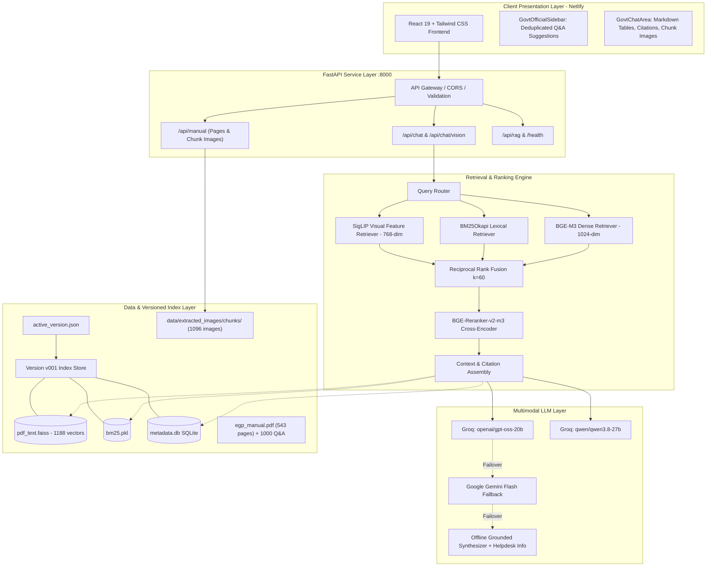

# Project Architecture: Enterprise Multimodal RAG Assistant

This document details the production architecture of the **Bangladesh e-GP Official Manual Assistant**.

---

## 1. System Architecture Overview

A complete PlantUML source file is available at [`PROJECT_ARCHITECTURE.puml`](file:///e:/E-gp%20Project%20manual/documents/PROJECT_ARCHITECTURE.puml).

---

## 2. Core Architectural Layers

### 2.1 Presentation Layer (Frontend)
- **Framework**: React 19 with Vite, Tailwind CSS, and Lucide icons.
- **Q&A Suggestion Deduplication**: `qaQuestionSuggestions.ts` hashes procedural question families using single-escaped normalization, reducing duplicate "Procedure Part 1–N" suggestions into a single representative question per procurement family.
- **Contextual Image Display**: Automatically resolves `/api/manual/chunk/{chunk_id}/image` so that the exact screenshot explaining the retrieved step is rendered inline with statutory citations.

### 2.2 API & Serving Layer (Backend)
- **Framework**: FastAPI (asynchronous ASGI, Python 3.12).
- **Security**: Strict image magic-byte verification (`verify_image_signature`), payload sanitation, and CORS origin controls.
- **Lifespan Management**: `load_rag_service()` loads versioned indexes and models once on startup, persisting memory across requests.

### 2.3 Multi-Channel Retrieval & RAG Pipeline
- **Dense Channel**: FAISS `IndexIDMap2(IndexFlatIP)` with BGE-M3 1024-dimensional normalized vectors.
- **Sparse Channel**: BM25Okapi inverted index covering procurement clauses, statutory rules (e.g. PPR-2008), and specific menu labels.
- **Visual Channel**: SigLIP 768-dimensional visual vectors matching user portal screenshots to manual diagrams.
- **Fusion**: Reciprocal Rank Fusion ($k=60$) combines channel scores without dimension bias.
- **Reranker**: BGE-Reranker-v2-m3 evaluates token interactions between query and fused passages.

### 2.4 Structure-Aware Image Ingestion & Storage
- **Image Extraction**: 1,096 images extracted from the 543-page manual via PyMuPDF C++ bindings.
- **Chunk Alignment**: Each image is bounded and linked to its owning `chunk_id`, `page`, `screen_reference`, and `related_sentence`.
- **Filesystem Convention**: `chunk_{chunk_id}_page_{page}_{order}_{slug}.png`.
- **Data Integrity**: 580 chunks in `chunks.json` and `metadata.db` are explicitly flagged as multimodal with verified screenshots; remaining chunks are cleanly designated as pure text.

### 2.5 Inference & Official Helpdesk Fallback
- **Primary LLM**: Groq-hosted `openai/gpt-oss-20b` (text) and `qwen/qwen3.8-27b` (multimodal vision).
- **Secondary LLM**: Google Gemini (`gemini-flash-latest`) automatic failover.
- **Synthesis Prompting**: Strictly synthesizes retrieved data into structured, professional prose (Markdown tables for fees, numbered lists for procedures, bold values).
- **Helpdesk Escalation**: If no supporting passage is found in manual records, the system politely declines to invent facts and immediately provides official Bangladesh e-GP Helpdesk contact channels (Hotline: `16575`, Phone: `+880 9609112233`, Email: `helpdesk@eprocure.gov.bd`).

---

## 3. Data Flow Comparison: Text Query vs. Vision Query

| Stage | Text Chat Query (`POST /api/chat`) | Screenshot Upload Query (`POST /api/chat/vision`) |
|---|---|---|
| **Input** | String query | Binary image file + optional prompt |
| **Validation** | String sanitation, character bounds | Magic-byte signature verification (PNG/JPEG/WEBP) |
| **Pre-Processing** | Query tokenization & routing | In-memory OCR + SigLIP visual embedding |
| **Retrieval** | Dense FAISS + Sparse BM25 + RRF | Visual SigLIP FAISS + OCR term retrieval |
| **Context** | Top-k chunks + citations + chunk images | Closest manual screen + verified step context |
| **Model** | `openai/gpt-oss-20b` | `qwen/qwen3.8-27b` |
| **Output** | Synthesized steps, tables, chunk screenshot link | Visual diagnostic, highlighted discrepancies, manual page reference |
